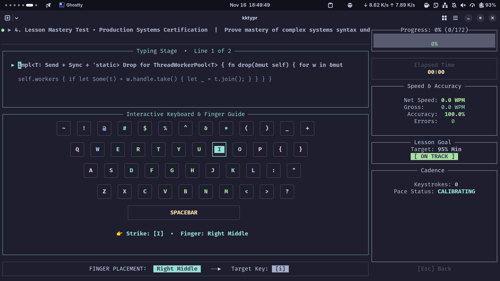
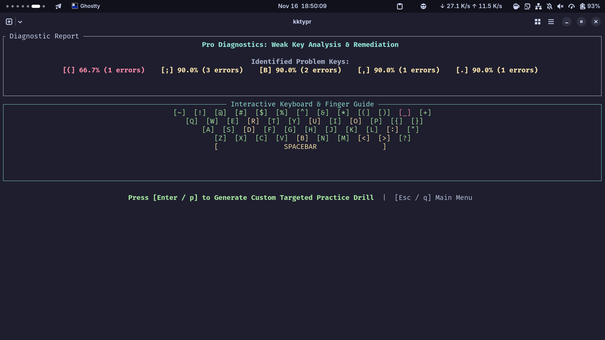
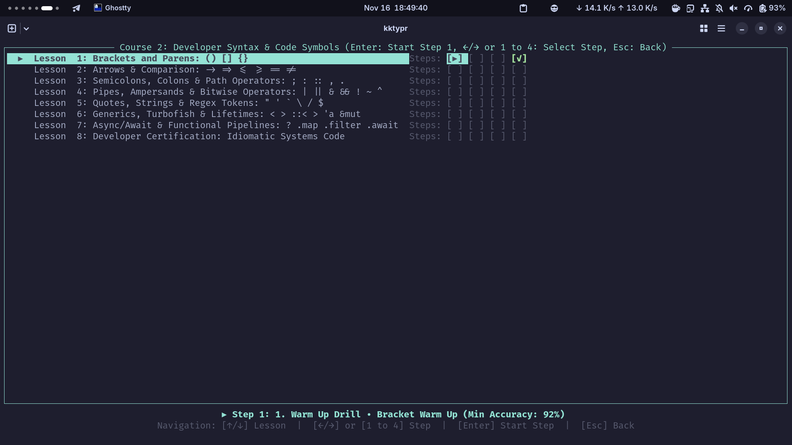
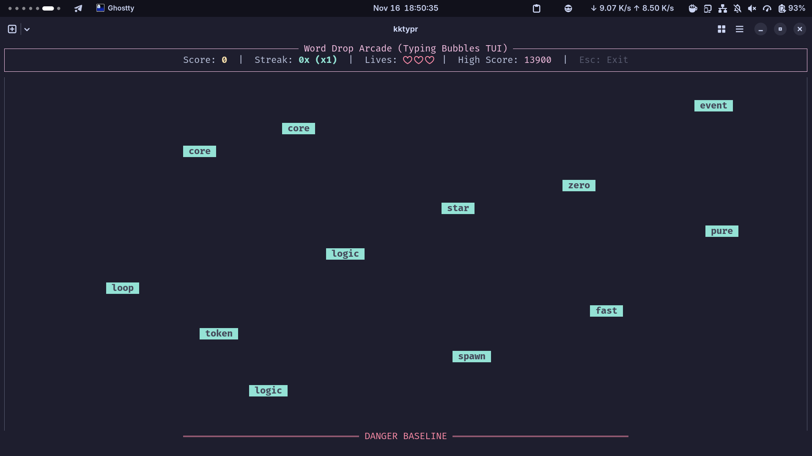
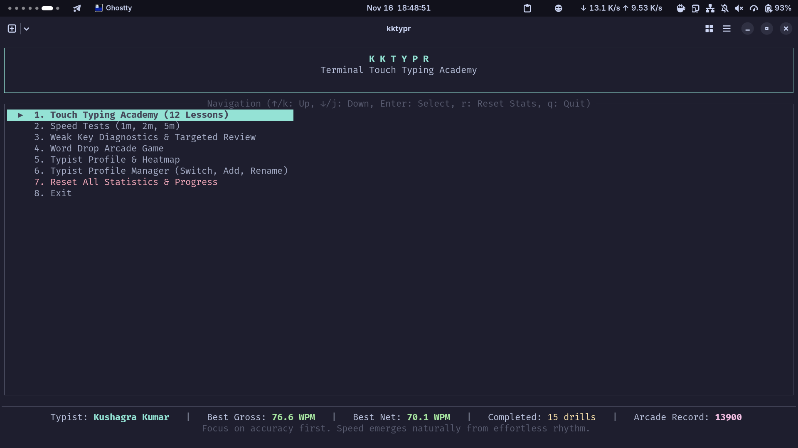
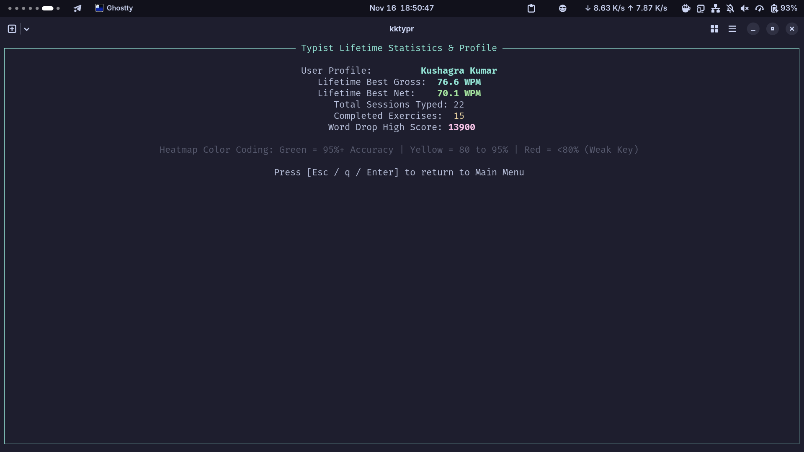

# kktypr

[](https://crates.io/crates/kktypr)
[](LICENSE)

> High-performance terminal touch typing tutor and developer code syntax training engine in pure Rust. Built on `ratatui` + `crossterm`.

<p align="center">
  
</p>

---

## Why kktypr?

Most typing software falls into two categories:
1. **Web-based casual tests** (like Monkeytype) that require a browser and primarily drill random English dictionary words rather than progressive muscle memory.
2. **Legacy desktop software** with heavy graphical runtimes, proprietary paywalls, or zero terminal integration.

**kktypr** is a keyboard training gym for developers. It bridges this gap with a sub-millisecond, native terminal user interface (TUI) combining structured touch typing fundamentals with real-world code syntax drills (brackets, lambda arrows, generics, turbofish, bitwise operators, and systems code) in a clean standalone binary.

### The Deliberate Practice Loop

1. **Learn the Reaches**: 12 touch typing lessons from home row to full punctuation with visual finger-zone guidance.
2. **Build Code Muscle Memory**: 8 developer lessons drilling real-world programming syntax (`->`, `::<>`, `?`, `&mut`, `|`).
3. **Diagnose Weak Keys**: Real-time accuracy and error frequency heatmap highlighting your slowest finger transitions.
4. **Targeted Drills**: An algorithmic drill synthesizer that procedurally generates practice sentences targeting your specific weak keys.
5. **Arcade Challenge**: 60 FPS falling-word arcade challenge ("Word Drop") testing word recognition and reaction speed under time pressure.

---

## Visual Tour

| Interactive Keyboard & Syntax Drill | Real-Time Weak Key Diagnostics |
| :---: | :---: |
|  |  |
| **Course 2: Developer Syntax & Code Symbols** | **Word Drop Arcade Mode** |
|  |  |
| **Retro-Modern Main Menu** | **Typist Lifetime Statistics & Heatmap** |
|  |  |

---

## Highlights

- **Pure Native Rust**: Built from scratch with `ratatui` and `crossterm`. Zero web views, sub millisecond input response, 60 FPS delta time arcade physics, and a lightweight standalone binary.
- **Dual Mode Typing Stage**:
  - **Natural Prose & Code Mode**: Continuous dynamic word wrapping to available terminal width. Words and code identifiers are never cut off or broken across lines. Features rolling multi line lookahead (preview upcoming lines in soft steel blue) and stationary 1 width cursor physics (letters never jitter or jump while typing).
  - **Key Drill Mode**: Spaced key tokens (`a s d f`) dynamically grouped and packed onto lines to fit any terminal geometry with zero edge clipping.
- **Course 1: Touch Typing Basics (12 Lessons, 48 Exercises)**:
  - Structured 4 phase pedagogical progression:
    - *Step 1: Warm Up Drill* (finger reach & rhythm calibration)
    - *Step 2: Word Drill* (real vocabulary using learned keys)
    - *Step 3: Sentence Drill* (natural fluid English sentences)
    - *Step 4: Mastery Test* (timed certification with 94%+ passing accuracy criteria)
  - Progressive curriculum from Home Row (`asdf jkl;`) through vowels, reaches, punctuation, and capital letters.
- **Course 2: Developer Syntax & Code Symbols (8 Lessons, 32 Exercises)**:
  - Tailored specifically for programmers typing complex punctuation and code idioms:
    - *Lesson 1: Brackets & Parens*: `() [] {}` (nested calls, array indexing, struct definitions)
    - *Lesson 2: Arrows & Comparison*: `-> => <= >= == !=` (match guards, lambda arrows, compound logic)
    - *Lesson 3: Semicolons, Colons & Path Operators*: `; : :: , .` (module use declarations, struct fields)
    - *Lesson 4: Pipes, Ampersands & Bitwise*: `| || & && ! ~ ^` (bitmasking, boolean conditions, match pipes)
    - *Lesson 5: Quotes, Strings & Regex Tokens*: `" ' ` \ / $` (interpolated templates, escape sequences)
    - *Lesson 6: Generics, Turbofish & Lifetimes*: `< > ::< > 'a &mut` (generic bounds, lifetime annotations)
    - *Lesson 7: Async/Await & Functional Pipelines*: `? .map .filter .await` (error try operator, method chains)
    - *Lesson 8: Systems Code Certification*: Idiomatic production systems syntax (unsafe pointer ops, thread joins)

- **Interactive Speed Test Suite**:
  - 1 Minute Sprint, 2 Minutes Standard Benchmark, and 5 Minutes Endurance Assessment.
  - Interactive menu with smooth arrow (`↑`/`↓`) and Vim (`k`/`j`) navigation, direct number keys (`1`/`2`/`5`), and live duration badges.
- **Universal Vim Navigation**: Full `h` / `j` / `k` / `l` / `q` navigation across Main Menu, Course Selection, Lesson Browser, Speed Tests, Profile Manager, and Statistics.
- **Interactive Visual Keyboard**: Box drawn Unicode keyboard with finger zone color coding (Pinky, Ring, Middle, Index, Thumbs), active key glow, centered spacebar, and live finger placement guidance pills.
- **Typist Profile Registry & Multi Profile Support**:
  - Create, switch, rename, or delete multiple typist profiles.
  - Atomic JSON persistence in standard XDG data directories (`~/.local/share/kktypr/profiles.json`) with automatic legacy data migration.
- **Pro Weak Key Heatmap**: Key by key accuracy and error matrix. Visual color coding (Green: ≥95%, Yellow: 80 to 94%, Red: <80%) highlights your exact weak fingers.
- **Dynamic Targeted Drill Synthesizer**: Analyzes lifetime weak keys and generates focused drill sentences targeting your specific problematic transitions.
- **Word Drop Arcade Game**: Real time falling word arcade mode with combo streak multipliers, danger floor baseline, dynamic terminal scaling, and local high score tracking.
- **Clean Room Standard**: 100% original Rust code, public domain prose, and original developer exercises. Zero trademarked assets or proprietary code traps.

---

## Keyboard Controls & Shortcuts

| Context | Keybindings | Action |
|---|---|---|
| **Global** | `Ctrl + C` | Force quit safely |
| **Main Menu** | `↑` / `k`, `↓` / `j` | Navigate menu items |
| | `Enter` / `l` | Select highlighted option |
| | `r` | Quick trigger stats reset confirmation |
| | `q` / `Esc` | Quit application |
| **Course Select** | `↑` / `k`, `↓` / `j` | Choose Course 1 (Basics) or Course 2 (Developer) |
| | `Enter` / `l` | Open course curriculum |
| | `Esc` / `q` / `h` | Return to Main Menu |
| **Lesson Select** | `↑` / `k`, `↓` / `j` | Browse lessons (auto-highlights next incomplete step) |
| | `←` / `h`, `→` / `l` | Select specific step within the lesson (Steps 1–4) |
| | `1`, `2`, `3`, `4` | Direct jump to step |
| | `Enter` | Start highlighted step |
| | `Esc` / `q` | Return to course selection |
| **Typing Stage** | Printable Characters | Type target characters (Green = Correct, Red = Error) |
| | `Backspace` | Undo previous character |
| | `Esc` | Pause / return to Lesson Select (retains active step) |
| **Scorecard** | `n` / `Enter` | Advance to next step or lesson |
| | `r` | Retry exercise |
| | `Esc` / `q` / `h` | Return to lesson selector |
| | `m` | Return directly to Main Menu |
| **Speed Tests** | `↑` / `k`, `↓` / `j` | Navigate duration (1 min, 2 min, 5 min) |
| | `Enter` / `l` | Start selected test |
| | `1`, `2`, `5` | Direct duration launch |
| | `Esc` / `q` / `h` | Return to Main Menu |
| **Profile Manager** | `↑` / `k`, `↓` / `j` | Browse profiles |
| | `Enter` / `l` | Switch active profile |
| | `a` | Add new profile |
| | `r` | Rename selected profile |
| | `d` | Delete profile (safeguarded) |
| | `Esc` / `q` / `h` | Return to Main Menu |
| **Word Drop Game** | `a`–`z` | Type falling words to pop them before they hit the floor |
| | `r` (Game Over) | Play again |
| | `Esc` | Return to Main Menu |

---

## Architecture

```text
kktypr/
├── .github/
│   └── workflows/ci.yml        # GitHub Actions CI (fmt, clippy, test, cross-platform)
├── Cargo.toml                  # Rust, ratatui 0.30, crossterm 0.29
├── LICENSE                     # Dual MIT / Apache 2.0 license declaration
├── src/
│   ├── main.rs                 # Terminal raw mode initialization, panic hook, 60 FPS event loop
│   ├── app.rs                  # Application state controller, screen router, key event dispatch
│   ├── engine/
│   │   ├── session.rs          # TypingSession state machine and backspace support
│   │   ├── metrics.rs          # Gross WPM, Net WPM, accuracy, and keystroke metrics
│   │   └── curriculum.rs       # Course 1 (Basics: 12 Lessons), Course 2 (Developer: 8 Lessons)
│   ├── analytics/
│   │   ├── heatmap.rs          # Key by key accuracy and error frequency matrices
│   │   ├── targeted.rs         # Algorithmic weak key drill generator
│   │   └── profile.rs          # Multi profile registry and atomic JSON storage
│   ├── game/
│   │   └── word_drop.rs        # Terminal falling word arcade physics loop
│   └── ui/
│       ├── mod.rs              # Frame router and overlay compositor
│       ├── theme.rs            # Color tokens and styling rules
│       ├── keyboard.rs         # Interactive box drawn visual keyboard widget
│       └── views/
│           ├── menu_view.rs    # Main menu, course browser, lesson select & speed test select
│           ├── lesson_view.rs  # Dual mode typing stage (prose word wrapping + key drills)
│           ├── dashboard.rs    # Weak key diagnostic reports & typist statistics
│           ├── game_view.rs    # Word Drop arcade canvas & danger baseline
│           ├── modal_view.rs   # Floating dialogs for typist profile creation/rename
│           └── profile_view.rs # Profile manager view (switch, add, rename, delete)
```

---

## Installation

### Via Cargo (Recommended)

Install directly from crates.io into `~/.cargo/bin`:

```bash
cargo install kktypr
```

Or install pre-compiled binaries instantly via `cargo-binstall`:

```bash
cargo binstall kktypr
```

Or install latest development version from GitHub:

```bash
cargo install --git https://github.com/kk376/kktypr
```

### Universal POSIX Installer

For automated environments, CI/CD runners, and quick setup:

```bash
curl -sSL https://raw.githubusercontent.com/kk376/kktypr/main/install.sh | bash
```

Then run it from anywhere in your terminal:

```bash
kktypr
```

*(Ensure `~/.cargo/bin` or `/usr/local/bin` is in your `$PATH`).*

Or install from a local clone:

```bash
git clone https://github.com/kk376/kktypr.git
cd kktypr
cargo install --path .
```

### Build from source

#### Prerequisites
- **Rust 1.88.0+ (MSRV)**
- Standard terminal emulator with UTF-8 support (Ghostty, Foot, Alacritty, Kitty, WezTerm, GNOME Terminal)

```bash
# Clone the repository
git clone https://github.com/kk376/kktypr.git
cd kktypr

# Run test suite
cargo test

# Build optimized release binary
cargo build --release

# Run kktypr
./target/release/kktypr
```

### Distribution Packages & Packaging Suite

Full package definitions, recipes, and build instructions are maintained in [`packaging/`](packaging/):
- **Arch Linux (AUR)**: [`packaging/arch/PKGBUILD`](packaging/arch/PKGBUILD) and root [`PKGBUILD`](PKGBUILD)
- **Debian / Ubuntu**: [`packaging/debian/`](packaging/debian/) and `cargo-deb`
- **Fedora / RHEL / Copr**: [`packaging/rpm/kktypr.spec`](packaging/rpm/kktypr.spec) and `cargo-generate-rpm`
- **Homebrew (macOS & Linux)**: [`packaging/homebrew/kktypr.rb`](packaging/homebrew/kktypr.rb)
- **Nix / NixOS**: Root [`flake.nix`](flake.nix) and [`packaging/nix/`](packaging/nix/)
- **Alpine Linux**: [`packaging/alpine/APKBUILD`](packaging/alpine/APKBUILD)
- **Void Linux**: [`packaging/void/template`](packaging/void/template)
- **Gentoo**: [`packaging/gentoo/`](packaging/gentoo/)
- **openSUSE**: [`packaging/opensuse/kktypr.spec`](packaging/opensuse/kktypr.spec)
- **Windows (Scoop)**: [`packaging/scoop/kktypr.json`](packaging/scoop/kktypr.json)
- **Android (Termux)**: [`packaging/termux/build.sh`](packaging/termux/build.sh)
- **KISS Linux**: [`packaging/kiss/`](packaging/kiss/)

---

## License

This project is dual-licensed under either:

- **MIT License** ([LICENSE-MIT](LICENSE-MIT) or [http://opensource.org/licenses/MIT](http://opensource.org/licenses/MIT))
- **Apache License, Version 2.0** ([LICENSE-APACHE](LICENSE-APACHE) or [http://www.apache.org/licenses/LICENSE-2.0](http://www.apache.org/licenses/LICENSE-2.0))

at your option.
